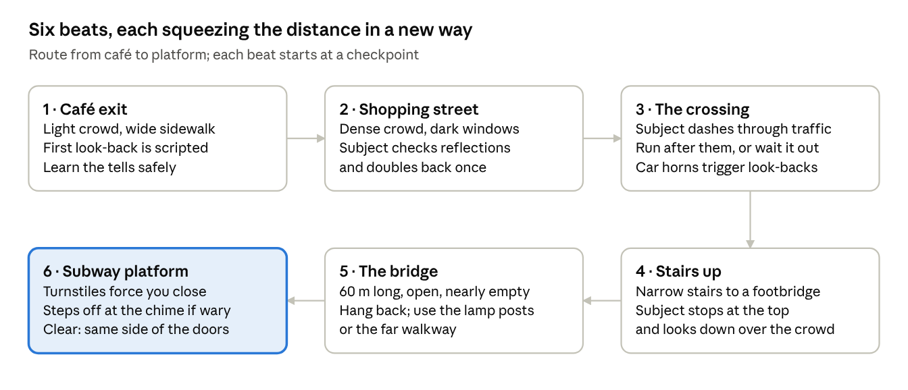

# Tailing prototype: design document

Copy of the [shared design doc](https://claude.ai/artifact/Mr4kKEzfgRw66kfEVG7Yda) as of 2026-11-10.

## Pitch and goals

The prototype is one continuous tail: follow a subject from a café to a subway platform without being spotted and without losing them. It uses the existing 2D top-down view and the grain post-process.

The target walks one of several routes through a busy district: shops, crowds, traffic, stairs, a footbridge and the subway. Every so often they check behind them, either directly or in a shop window's reflection. You keep them in sight from far enough back that, when they look, you are just another coat in the crowd.

The prototype has to answer four questions:

1. Is the push and pull fun on its own: too close and you are spotted, too far and you lose them?
2. Can players see a look-back coming and react in time?
3. Do shop-window reflections read clearly from above, both as a threat and as a tool?
4. Does each street feature (crowds, traffic, stairs, the bridge, the train) change the distance game in a new way?

## Core loop

Following is a tug of war between two ways to fail: get too close and the target spots you, fall too far back and you lose them. The street keeps moving the safe distance, so you never get to settle into it.

Moment to moment, the player:

1. Watches the target for the tell that they are about to look back.
2. Picks a way to be unremarkable when they look: drop back, step into a doorway, stop at a shop window, or melt into a crowd.
3. Closes the gap when the target turns a corner, enters a crowd or takes stairs, because that is when sight breaks.
4. Falls back on open stretches like the bridge, where seeing them is easy but hiding is not.

The resulting rhythm is the classic tailing rule: close up before corners, hang back on straights. Two things drive it: **sightings**, how many times the subject has noticed you (three and they've made you), and **contact**, whether you still know where they are.

## The target

The subject wears a grey coat and carries a red briefcase. It is the only red thing on the street, and the shader passes saturated colours through untouched, so the briefcase is what your eye locks onto in a crowd.

**Route.** The subject follows hand-authored paths, and at branch points they pick between variants, so no two attempts run through the same streets. Each waypoint can carry one action:

- Pause: window-shop, buy a paper, wait at a light.
- Look back: a check over the shoulder.
- Check reflection: stop at a shop window and watch the glass.
- Change pace: speed up, slow down, or dash.
- Double back: turn around and walk back 10 to 20 m before carrying on.
- Transition: take stairs, cross a road, board the train.

**Look-backs.** Some are scripted at fixed waypoints and others come on a random timer. They come in two kinds. A full look-back stops the subject and plays in three parts, so the player always gets a warning:

1. Tell, 0.7 s: they slow down, the hat starts to turn, and their footsteps stop.
2. Look, 1.5 s: a pale cone sweeps the street behind them, drawn like the flashlight in the demo.
3. Resume: they face forward and walk on.

A **glance** happens mid-stride: the subject keeps walking and turns their head most of the way back over one shoulder for about 0.6 s. The shoulders twist part of the way and the head does the rest, while the legs keep walking forward; the hat's brim points where they're looking. Its tell is shorter, 0.3 s of the hat starting to turn, with no slow-down. The cone is narrower and aimed over that shoulder, so the strip directly behind them and the other side stay blind.

Random look-backs can be either kind; while the subject is calm, most of them are glances.

**Suspicion changes behaviour.** Each time the subject notices you is a sighting, and each sighting moves them up one of four states. Sightings never come back: a wary subject stays wary.

| State | Sightings | Behaviour |
| --- | --- | --- |
| Calm | 0 | Scripted look-backs plus a random one every 12 to 18 s. Stays on the train. |
| Wary | 1 | Random look-backs every 6 to 10 s. Checks the reflection at 1 in 4 of the dark windows they pass. Changes pace. Steps off the train at the last moment. |
| Suspicious | 2 | Also doubles back, stops dead, and crosses the street to see who crosses with them. |
| Burned | 3 | They have made you, and the subject bolts. You get one chance to recover. |

**Recovery.** When the subject bolts, they run for the nearest crowd or side street, glancing back often. Keep them in sight without being seen again for the recovery time, and they think they have shaken you: they slow down and rejoin the route suspicious, with one sighting left: the only time a sighting comes back. If they spot you again or you lose them first, the attempt fails, and you get one recovery per attempt.

## Detection rules

The subject can only notice you while they can see you: during a look-back, in a reflection, from the top of a staircase, or straight ahead after doubling back toward you. While they see you, a noticing bar fills, and when it's full that's a sighting. How long that takes depends on how far back you are. Get out of their sight before it fills and it drains away without counting.

| Behind the subject | Band | Time to notice you, in the open |
| --- | --- | --- |
| Over 35 m | Lost | No contact: the lost timer runs |
| 20 to 35 m | Far | They can't pick you out |
| 10 to 20 m | Tail zone | 2.5 s: one look-back doesn't catch you unless you're running, but the subject walking back toward you does |
| 4 to 10 m | Close | 1.2 s: a full look-back catches you |
| Under 4 m | Too close | 0.5 s: almost any look |

Past 20 m the subject can't pick you out, but crowds and corners break your sight. Inside 4 m, any look notices you almost at once.

**Glances.** A glance is a quick, deliberate check, so it notices twice as fast: one that catches you within 4 m is a sighting, and further back it fills part of the bar.

**Modifiers** change how fast the subject notices you. Cover (peeking, a crowd, a doorway) takes the place of how fast you're moving; hurrying or running takes you out of a crowd or doorway. Walking in a crowd also keeps you to its pace.

| What you are doing when seen | Noticing speed |
| --- | --- |
| Peeking around a corner | ×0.2 |
| Moving with a crowd (3 or more pedestrians within 2 m) | ×0.3 |
| Browsing a shop window or standing in a doorway | ×0.5 |
| Standing in a lit window's light | ×1.3, on top of the rest |
| On the opposite sidewalk | ×0.6 |
| Walking at crowd pace | ×1 |
| Standing still and facing the subject | ×1.5 |
| Hurrying | ×1.5 |
| Running | ×3 |

**One look, one sighting.** Once a look has counted, it can't count again: you have to be out of their sight for 2 s before they can notice you afresh. A tail usually gives itself away by being the same stranger again and again, so dodging every look matters more than surviving one.

**Getting away with it.** Out of their sight, the noticing drains from full to empty in under a second. Sightings never drain.

**Line of sight.** Walls, parked cars, buses and kiosks block sight in both directions. Each pedestrian blocks a disc about as wide as their shoulders, so a thick crowd hides you and also hides the subject. Someone standing right on either end of the line doesn't count.

## Keeping track

You have contact while the subject is in front of the spy, inside their view, with a clear line of sight within 35 m, or while they show in the dark window the spy is looking at. The street is always drawn, but people and cars only appear inside the spy's sight, so you know where the subject is only while you can actually see them.

When contact breaks:

- The subject fades out, and after half a second a last-seen marker appears where you last saw them, with an arrow for their heading. The delay keeps someone walking past from flashing it up.
- An 8 s lost timer starts, shown as a ring shrinking around the marker.
- Seeing the subject again, even for a moment, refills the timer.
- If the timer runs out, the subject is lost and the attempt restarts at the last checkpoint.

The short timer is what makes corners tense. At walking pace, 8 s covers about 12 m, so if the subject turns a corner 25 m ahead of you, they are gone before you reach it.

## Cover and hiding

Cover either breaks the subject's line of sight or makes you look like part of the street, and every kind costs you something.

| Cover | How it works | The catch |
| --- | --- | --- |
| Corner | Hug the wall and peek: you see around it and show only a sliver | You are standing still while the subject keeps walking |
| Doorway | Step into a shop entrance, out of sight from the same sidewalk; stopping in it turns you to face the street | Useless once the subject crosses to the other side |
| Crowd | Pedestrians block sight, and moving with them slows the noticing | The crowd hides the subject too, and sets your pace |
| Shop window | Stop and browse, like any shopper | A dark window can also show you to the subject |
| Parked car, kiosk, bus shelter | Solid blockers along the curb | Few of them, and none on the bridge |
| Opposite sidewalk | Tail in parallel from across the road | Traffic blocks your view, and crossing back is risky |

Pedestrians walk in sidewalk lanes, wait at lights, and bunch up at shops, stairs and turnstiles. When the spy runs, the people nearby stop and turn to look, which breaks the crowd cover around you.

**Hugging walls and peeking.** Press E next to a wall, parked car or kiosk to put your back to it, and sidestep along it; building fronts carry on from one block to the next. At an outside corner, keep pushing toward it to lean out: you see from your leaning head, so the street round the corner opens up, and the subject can only see that head. Stepping away from the wall, running or pressing E again lets go. Doorway walls work too, so you can peek out of a doorway.

**How the crowd works (step 2).** About 100 people walk alone or in groups of two to four, keeping to the right of walkways laid along the sidewalks, over the crosswalks and up the side street. They come out of shop doors and in from the street ends and head for another door or end, sometimes stopping at a shop window on the way. Walking with three or more people within 2 m who are going your way counts as a crowd; people staring at you don't count.

## Reflections

Shop windows are mirrors that work for both sides. The subject uses them to check behind without turning around, and you use them to see around corners.

**Which windows reflect.** Only dark windows reflect; a lit shop window is see-through. Dark glass is drawn with a thin bright edge, so the player can tell at a glance which windows are mirrors. That also gives the level designer a simple way to tune each stretch of street.

**Lit windows.** A lit window throws a soft pool of light on the pavement in front of it, a 2D light that falls on the ground and on people but not on roofs or the shading of what the spy can't see. Standing in it makes the subject notice you 1.3 times as fast, and "in the light" shows under the meter when you're in no cover. Lit windows are spots to avoid; dark ones are mirrors to use.

**How it works from above.** Each window is a line segment along a building front. To find what someone sees in it, mirror their position across that line; everything inside the wedge from the mirrored point through the window's two ends, on the street side, is visible in the glass, as long as both halves of the real path (to the glass, then on to the point) are clear of walls and people. Distance counts the whole path. A wedge is drawn as a pale shape on the pavement.

**Both wedges move.** Each one reshapes every frame as its owner walks, so the safe spots around a window shift with every step. The spy's wedge shows, faint and dashed, only for the dark window they're looking at, and brightens while the subject is in it. The subject's shows only while they're checking the glass. Reflections work both ways: if the subject is inside your wedge, you are inside theirs, and only their attention decides whether you are seen.

**The subject's reflection check.** At a few set points on the route, and now and then once they're wary, the subject stops and watches a dark window for 2 s. Once wary there's a 1 in 4 chance at each dark window they pass, 1 in 2 once suspicious, and never two checks within 10 s. The tell is that they slow down and turn to the glass for half a second first. Anything inside their wedge is seen, and the noticing goes by the distance along the path through the glass.

**The spy's reflection view.** The spy uses one dark window at a time: the one they're facing, within 45° of the way they face and up to 8 m away. It shows you what's in its glass, with nothing to press: if the subject shows in it, you have contact. The closer you are, the more it shows: right at the glass you see 18 m of street in it, at 8 m only 4 m, and the further back you stand the narrower the slice of street the glass covers. Facing means the way the spy last walked or turned, so turn toward a window to use it; the street doesn't fill up with patches from every window you pass. With the spy seeing only what's in front of them, the glass is how you watch the street behind you: browse a dark window with your back to the street and the subject shows in it. The corner buildings at the side street also have dark windows on their side walls, which the subject can stop and check as they walk up it.

**Browsing.** Press E in front of a shop window to stop and browse it, facing the glass. It counts as cover, like a doorway. Walking off ends it. Anywhere else along a wall, E hugs the wall as before.

## The street route

The route runs from a café to a subway platform in six beats, and each beat changes what a safe distance looks like. The beats always come in this order, but each one has two or three street variants for the subject to choose from.

*The subject's route, 6 beats.*

The subway beat is cleared when the train doors close with you on the same side as the subject: both aboard, or both on the platform. If the subject steps off at the chime and sees you step off after them, you are burned at once.

**Endings.** The tail is not the whole mission. After the train, the subject heads to the mission's end point, where an objective plays out that changes from mission to mission:

- Steal something from the subject without being noticed.
- Photograph a handoff from a spot with a clear view.
- Find out which building they enter.
- Find out who they meet.

More ideas in the same physical spirit: swap their briefcase for an identical one in a crowd, plant a tracker on them, or pick up what they leave at a dead drop once they have moved on.

Stairs link three levels: the street, the footbridge and the station. Each level is its own layer, and the bridge casts a long shadow on the street below using the existing shadow script.

## Player, controls and camera

The spy moves the same way as in the demo: 8-way movement, with the body turning to face the direction of travel. The default walk matches the crowd's pace, so walking never draws attention on its own.

| Keyboard / gamepad | Action |
| --- | --- |
| WASD / left stick | Walk at crowd pace; a quick tap turns on the spot |
| Shift / left trigger, hold | Hurry |
| Space / A, hold | Run |
| E / X next to a wall | Hug the wall; push toward the corner to peek |
| E / X at a shop window | Browse it: cover, facing the glass. Facing a dark window within 8 m shows you what's in its glass anyway |

**Camera.** The camera follows the spy and leans toward the subject's last known position, so both usually fit on screen. It pulls back on the bridge and moves in underground.

**Reading the street in the grain look:**

- Areas outside the spy's sight are darker and grainier, which the existing post-process can do with a sight mask.
- The spy sees what's in front of them: a 180° view around the way they face, fading out over its last 15° at each side. Behind them the street is shaded like behind a wall, and people there aren't shown. The subject behind you is out of sight, and the lost timer runs.
- The subject's red briefcase passes through the colour grade untouched.
- Look-back cones and reflection wedges are pale and translucent, like the flashlight in the demo.
- Three marks at the top of the screen are the sightings the subject can make; one fills with each sighting. Under them, a bar fills while the subject is noticing you and drains when you get out of sight. While the subject is looking right at the spy, the bar pulses and says SEEN, the cone that caught them brightens, and a ring pulses around the spy. Grain and vignette tighten with each sighting, and the subject's posture changes with each state.
- The cover you're in shows under the middle of the meter: "in a crowd", "in a doorway", "browsing a window" or "peeking"; out of cover, "in the light" warns you're standing in a lit window's glow. People, parked cars and kiosks cut shadows out of the subject's cone, so you can see who's hiding you.
- Parked cars and kiosks shade the street behind them like walls do. People don't, or a crowd would cover the street in flickering shadows; only the people hiding the subject from you throw a soft streak of shadow toward where the subject is.
- While you hug a wall, a pale line runs along it at your back.
- The sighting marks and noticing bar, the last-seen marker and its lost-timer ring are the only HUD. A debug overlay on F2 shows the exact noticing and bands for playtesting.

## Prototype scope

Build it in five steps. Each one is playable and answers one question before the next step adds more.

| Step | Adds | Playtest question |
| --- | --- | --- |
| 1. One street | Grey-box street with one corner, the subject's route with look-backs and tells, sightings, contact, the lost timer, spy movement, restart | Is keeping the distance fun with nothing else in the way? |
| 2. Crowd and cover | Pedestrians, crowd blending, doorways, corner peeks, parked cars and kiosks | Does the crowd make the tail easier and harder at the same time? |
| 3. Reflections | Dark and lit windows (lit ones as 2D lights), the subject's reflection checks, browsing a window, the spy's reflection view | Can players read the wedge from above without being told? |
| 4. Traffic | Road lanes, cars and a bus as moving blockers, lights, horns, the subject's dash | Is running through traffic a real choice rather than the only one? |
| 5. Stairs, bridge, subway | Stairs between levels, the open bridge, turnstiles, the train and its doors, and the ending: seeing which building the subject enters | Do the last beats feel different from the street? |

**Out of scope:** combat, dialogue, disguises, more than one target, a procedural city, final art, sound beyond placeholder cues, saving and menus.

It reuses the grain post-process, the top-down spy sprite, and the drop-shadow script for buildings from the current project.

## Starting tuning values

These are starting points for the first playtest, not final numbers. The prototype uses 48 px per metre, which makes the spy sprite about 1 m across, coat included. Values already given above (distance bands, modifiers, timers) are not repeated here.

| Value | Start | Notes |
| --- | --- | --- |
| Spy walk | 1.5 m/s | Same as the crowd |
| Spy hurry | 2.5 m/s | |
| Spy run | 4.5 m/s | |
| Subject walk | 1.4 m/s | A little slower than the spy, so gaps can be closed |
| Subject dash | 4 m/s | The crossing only |
| Pedestrians | 1.2 to 1.6 m/s | |
| Cars | 10 m/s (36 km/h) | Buses 7 m/s |
| Look-back cone | 120°, 20 m; a glance 60° | Matches the edge of the distance bands |
| Forward vision | 110°, 20 m | |
| Looking down from the top of stairs | 30 m, all around | Sees over crowds |
| Camera zoom | 0.9, about 30 × 17 m on screen | 0.75 on the bridge, 1.1 underground. At 0.6 the mocks showed people too small to read |
| Camera lean | Up to 30% of the screen | Toward the last known position |
| Train doors | Open 8 s | Chime 2 s before they close |
| Checkpoints | Start of each beat | |
| Recovery time | 10 s | Configurable per mission |
| People on the street | 100 | Groups of 1 to 4: 30%, 25%, 25%, 20% |
| A person's sight blocker | 0.3 m radius | About shoulder width from above |
| Crowd | 3 people within 2 m, going your way | |
| Running startles | People within 6 m, for 1.5 to 2.5 s | |
| Parked cars | About one every 30 m on each curb | None at the crosswalks or across from the side street |
| Hugging a wall | 1 m/s sidestep; the head leans 0.35 m past a corner | |
| Last-seen marker delay | 0.5 s | |
| Noticing drain | Full to empty in about 0.7 s | |
| Glances | Notice twice as fast | |
| A new sighting | After 2 s out of the subject's sight | |
| Mirror view | The dark window the spy faces, within 45° and 8 m | Shows 18 m into the reflection at the glass, falling to 4 m at 8 m away |
| Glass checks | 0.5 s tell, 2 s watching; 1 in 4 dark windows once wary, 1 in 2 once suspicious; 10 s apart | |
| Spy's view | 180°, the last 15° each side fading out | Seen up to the middle of the fade |
| Tap to turn | A press under 0.15 s from standing turns on the spot | Holding walks |
| Window light | ×1.3 noticing in the pool | |

## Open questions

Each of these needs your call before implementation starts. Where the doc already assumes an answer, it is marked as proposed.

- [x] Should the screen show only what the spy can see (proposed), or the whole street from above? This decides whether corners and peeking matter at all.

  **Decided:** start with only what the spy can see, and revisit after the first playtest.
- [x] When the subject makes you, should the attempt restart at once (proposed), or should they bolt and give you a short chase to recover?

  **Decided:** the subject bolts and you get one chance to recover; see Recovery under The target.
- [x] If a car hits the spy, does the attempt fail, or are you knocked down for a few seconds?

  **Decided:** a car knocks the spy down for a few seconds (3 s to start) instead of failing the attempt.
- [x] Should the route be the same every attempt with random look-back timing (proposed), or should the subject choose between route variants?

  **Decided:** the subject chooses between route variants, and look-back timing stays random.
- [x] Should heat stay invisible apart from grain, vignette and posture (proposed), or have a small meter?

  **Decided:** heat starts invisible, shown only through grain, vignette and posture, and gets revisited after the first playtest.

  **Revised after the first playtest:** being inside a look-back cone often changed nothing you could see, so it was hard to tell when a look counted. Heat now has a small meter, and being seen has its own cue (see Reading the street).

  **Revised after step 2:** heat is gone. The subject can notice you three times, one sighting per alert level, and a bar shows them noticing you before it counts. After playing it, the times to notice were doubled: at first a single look-back from the tail zone used up a third of the budget.
- [x] Is the train the end of this mission, or does it lead into another physical task, such as photographing a handoff?

  **Decided:** the train is not the end. Each mission closes with an objective; see Endings under The street route.
- [x] Which ending should the prototype build first? Proposed: finding out which building they enter, since it needs no new mechanic.

  **Decided:** the prototype ends by finding out which building the subject enters. You have to see them go through the door.
